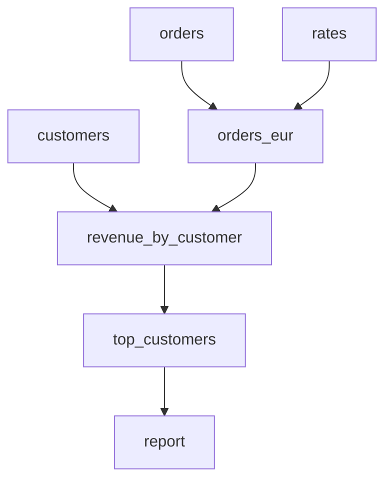

# dagflow

[](https://github.com/Akshay-Sonare/dagflow/actions/workflows/ci.yml)


**A lightweight, async-first task orchestration engine** — think a pocket-sized
Airflow/Prefect with zero runtime dependencies.

Write plain Python functions. Name a parameter after another task and dagflow wires
up the dependency, then runs the whole graph concurrently with retries, timeouts,
result caching and a live CLI.

```python
from dagflow import Workflow

wf = Workflow("etl")


@wf.task(retries=3, backoff=0.5, retry_on=(ConnectionError,))
async def orders():  # async tasks run on the event loop
    return await fetch_orders()


@wf.task(timeout=10)
def rates():  # sync tasks run on worker threads
    return load_exchange_rates()


@wf.task(cache=True)
def revenue(orders, rates):  # depends on `orders` and `rates`
    return sum(o.amount * rates[o.currency] for o in orders)


result = wf.run(max_concurrency=4)
print(result["revenue"])
```

## Features

| | |
|---|---|
| **Dependency injection** | Parameters named after tasks receive their results (pytest-fixture style); other parameters come from run params or defaults. |
| **Event-driven scheduler** | A task starts the instant its last dependency finishes, not when a whole "layer" is done. Bounded by a concurrency semaphore. |
| **Sync + async** | `async def` tasks are awaited; blocking functions are moved to threads automatically. |
| **Retries** | Exponential back-off with a cap and exception filtering. Back-off sleeps don't hold a concurrency slot. |
| **Timeouts** | Per-attempt, distinguishing a real timeout from a `TimeoutError` the task raised itself. |
| **Failure handling** | Failed tasks skip only their descendants; independent branches keep going. `fail_fast=True` cancels everything instead. |
| **Caching** | Content-addressed keys over the task's *bytecode* and canonicalised inputs, so editing a task invalidates its cache. In-memory and SQLite backends, or bring your own via a `Protocol`. |
| **Validation up front** | Cycles (with the offending path), unknown tasks and missing inputs are reported before anything runs. |
| **Partial runs** | `targets=[...]` runs only the requested tasks and their ancestors. |
| **Observability** | Typed lifecycle events on a pub/sub bus; the CLI's live reporter is just one listener. |
| **Visualisation** | Export the graph as Mermaid or Graphviz DOT. |

## Install

```bash
git clone https://github.com/Akshay-Sonare/dagflow.git
cd dagflow
python -m venv .venv && source .venv/bin/activate
pip install -e ".[dev]"
```

## CLI

The repo ships with [an example pipeline](examples/sales_report.py) that pulls
from three simulated sources, one of them flaky:

```bash
dagflow run examples/sales_report.py -p region=EU -p top_n=3 --cache .dagflow.db
```

```
running workflow 'sales_report'
  ▶ customers
  ▶ orders
  ▶ rates
  ↻ orders — ConnectionError: orders API returned 503 [retrying in 0.10s]
  ✓ customers 0.30s
  ...
  ✓ report 0.00s

task                 state      tries     time
customers            success        1    0.30s
orders               success        3    0.92s
...
workflow 'sales_report' succeeded in 0.93s (7 success)
```

Other commands:

```bash
dagflow plan  examples/sales_report.py              # execution stages + required params
dagflow graph examples/sales_report.py              # Mermaid diagram
dagflow graph examples/sales_report.py -f dot | dot -Tpng > graph.png
dagflow run   examples/sales_report.py -t revenue_by_customer --json
```

The example's graph, as produced by `dagflow graph`:



## Architecture

```
src/dagflow/
├── task.py       Task dataclass, RetryPolicy, @task decorator (signature introspection)
├── graph.py      DAG: Kahn topological sort, cycle path extraction, layers, subgraphs, exports
├── workflow.py   Workflow: registration, graph building, validation, run()/arun()
├── executor.py   Async scheduler: semaphore, retries, timeouts, skip/cancel propagation
├── cache.py      Cache Protocol, MemoryCache, SQLiteCache, deterministic cache keys
├── events.py     Event types and EventBus
├── errors.py     Exception hierarchy rooted at DagflowError
└── cli.py        argparse CLI and live console reporter
```

How a run works:

1. `Workflow.validate()` builds the `DAG` from task signatures, trims it to the
   requested targets, topologically sorts it (raising `CycleError` with the cycle
   path) and checks every input has a source.
2. `Executor.execute()` launches every task with no pending dependencies as an
   `asyncio.Task`, then loops on `asyncio.wait(..., FIRST_COMPLETED)`.
3. Each success decrements its children's pending-dependency counters; children
   reaching zero are launched immediately. Each failure marks its descendants
   `SKIPPED` (or, with `fail_fast`, cancels all in-flight work).
4. Every state change is published as an `Event`, which the CLI renders live.

## Development

```bash
pytest --cov          # tests (+ doctests) with coverage
mypy                  # strict type checking
ruff check . && ruff format --check .
```

CI runs lint and type checks, plus the test suite on Linux, macOS and Windows
across Python 3.11 – 3.13.

## License

MIT
